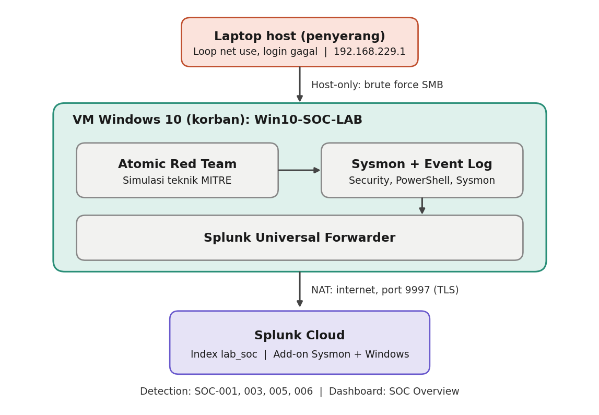
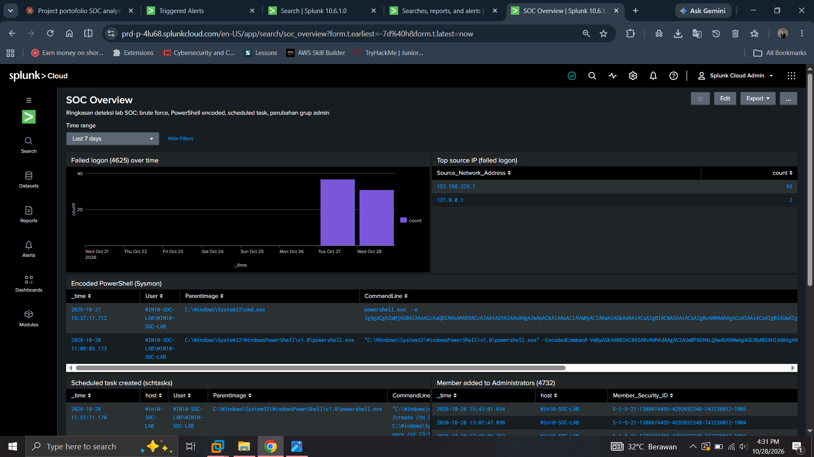

# SOC Detection & Investigation Lab

Lab mandiri untuk melatih alur kerja SOC Analyst L1: mengumpulkan log endpoint ke Splunk, mensimulasikan serangan, membuat detection rule berbasis SPL, memantau lewat dashboard, lalu menulis incident report.

> **Catatan jujur:** serangan disimulasikan dari laptop host dan Atomic Red Team di dalam VM. Semua insiden dalam repo ini adalah aktivitas lab, bukan kejadian nyata.

## Arsitektur



| Komponen | Detail |
|---|---|
| Endpoint (korban) | VM Windows 10 Enterprise Evaluation (VMware), RAM 2,5 GB |
| Telemetri | Sysmon (konfigurasi SwiftOnSecurity), Windows Security log, PowerShell Operational log |
| Pengirim log | Splunk Universal Forwarder, TLS ke Splunk Cloud (port 9997) |
| SIEM | Splunk Cloud (trial), index `lab_soc` |
| Parsing | Splunk Add-on for Sysmon, Splunk Add-on for Microsoft Windows |
| Penyerang | Laptop host (jaringan host-only) dan Atomic Red Team |
| Jaringan VM | Adapter 1 NAT (kirim log ke internet), adapter 2 host-only (jalur serangan) |

## Detection rule

| ID | Nama | MITRE ATT&CK | Sumber log | Severity | Dokumentasi |
|---|---|---|---|---|---|
| SOC-001 | Brute Force SMB | T1110.001 | Security 4625 | High | [detail](detections/SOC-001-brute-force-smb.md) |
| SOC-003 | Encoded PowerShell Command | T1059.001, T1027 | Sysmon EventCode 1 | High | [detail](detections/SOC-003-encoded-powershell.md) |
| SOC-005 | Scheduled Task Created via schtasks | T1053.005 | Sysmon EventCode 1 | Medium | [detail](detections/SOC-005-scheduled-task.md) |
| SOC-006 | Member Added to Local Administrators | T1136.001, T1098 | Security 4720, 4732 | High | [detail](detections/SOC-006-local-admin-added.md) |

Semua alert berjalan terjadwal tiap 5 menit dengan jendela 15 menit, mode Once, throttle 15 menit.

## Incident report

| ID | Judul | Klasifikasi |
|---|---|---|
| [IR-001](incident-reports/IR-001-brute-force-smb.md) | Brute force SMB terhadap akun administrator | True positive (simulasi) |
| [IR-002](incident-reports/IR-002-encoded-powershell.md) | Eksekusi PowerShell ter-encode dan ter-obfuscate | True positive (simulasi) |
| [IR-003](incident-reports/IR-003-new-admin-account.md) | Akun lokal baru ditambahkan ke grup Administrators | True positive (simulasi) |

## Dashboard

Dashboard klasik `SOC Overview` (kode: [dashboards/soc-overview.xml](dashboards/soc-overview.xml)) berisi failed logon dari waktu ke waktu, top source IP, PowerShell ter-encode, scheduled task, perubahan grup Administrators, akun baru, dan volume event per sumber.



## Simulasi serangan

| Skenario | Teknik | Cara | Bukti |
|---|---|---|---|
| Brute force SMB | T1110.001 | Loop `net use` dari host ke VM | [folder](attack-simulation/brute-force/) |
| PowerShell ter-encode | T1059.001 | Atomic Red Team T1059.001-17 | [folder](attack-simulation/powershell-encoded/) |
| Scheduled task | T1053.005 | Atomic Red Team T1053.005-2 | [folder](attack-simulation/scheduled-task/) |
| Akun admin baru | T1136.001 | Atomic Red Team T1136.001-8 | [folder](attack-simulation/new-admin-account/) |

Setiap skenario dibersihkan (cleanup) setelah pengujian, dan buktinya ada di folder masing-masing.

## Struktur repo

```
architecture/        diagram dan bukti pipeline log
attack-simulation/   bukti simulasi serangan per skenario
detections/          dokumentasi rule (SPL, MITRE, false positive, tuning)
dashboards/          XML dashboard dan screenshot
incident-reports/    laporan insiden
lessons-learned.md   masalah yang ditemui dan solusinya
```

## Keterbatasan

- Lab satu endpoint, tanpa Active Directory, jadi tidak mencakup pergerakan lateral.
- Waktu deteksi sekitar 8-9 menit pada rule berbasis Sysmon karena jadwal cron 5 menit ditambah jeda pengiriman log.
- SOC-005 hanya menangkap task yang dibuat lewat `schtasks.exe`, bukan lewat API (`Register-ScheduledTask`, COM).
- Rule diuji pada data lab kecil, jadi angka false positive di lingkungan nyata belum diketahui.
- Splunk Cloud trial berakhir, jadi bukti utama berupa teks SPL, XML dashboard, dan screenshot.

## Rencana pengembangan

- SOC-002: banyak login gagal lalu sukses dari IP yang sama
- SOC-004: script block PowerShell ter-obfuscate (EventCode 4104)
- Rule untuk event Security 4698 agar task yang dibuat lewat API juga terdeteksi
- Menambah endpoint Linux (auth.log dan SSH)

## Teknologi

Splunk Cloud, SPL, Splunk Universal Forwarder, Sysmon, Windows Event Log, Atomic Red Team, MITRE ATT&CK, VMware Workstation, PowerShell.
